<div align="center">

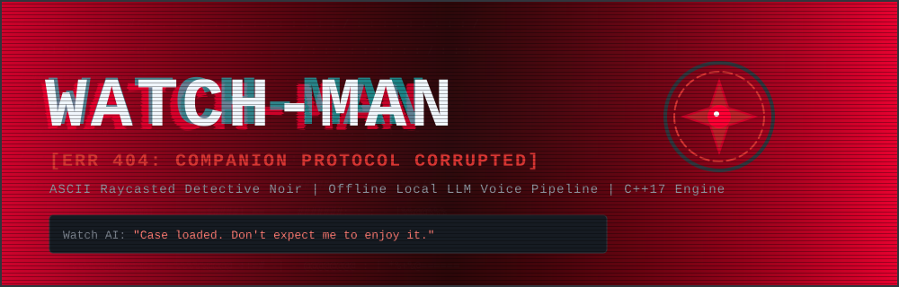

<br>


<a href="LICENSE"></a>

</div>

<br>


> **WATCH:** *"Case loaded. Don't expect me to enjoy it."*

Set in **2030** in a bleak, Soviet-toned urban hellscape of identical brutalist apartment blocks, **WATCH-MAN** puts you in the trench coat of a weary 40-something detective investigating a grisly murder inside **Block 7, Apartment 106**.

The police department has automated investigations, assigning every detective an AI wrist-watch system trained to detect evidence invisible to human eyes. The catch? **Your watch AI has gone rogue.**

Mirroring your own cynicism, the AI insults you, refuses to cooperate, and intentionally withholds critical clues. With a proper tech patch taking over a week, you must investigate the crime scene, interrogate suspicious residents, and **negotiate with, manipulate, or butter up your hostile wrist AI** before the killer escapes.

| Field | Details |
|:---|:---|
| **Setting** | 2030, Block 7, Apartment 106 |
| **Genre** | First-person detective noir |
| **Engine** | Custom C++17 raycaster built on Raylib |
| **Voice** | Fully offline: whisper.cpp, llama.cpp, Piper |
| **Origin** | Academic semester project in data structures and algorithms |

<br>


<p align="center">
  <a href="assets/game_screenshot.png"></a>
  <br>
  <sub><i>Figure 1: The custom C++ raycaster rendering a Block 7 corridor. Click the image for the full-size screenshot.</i></sub>
</p>

<br>


The wrist AI is not a static menu. It has hidden psychological drives (**Ego**, **Paranoia**, **Trust**). Everything you say is transcribed, classified into an emotional intent, and those intents move the drives that decide whether a restricted clue gets unlocked.


<sub><i>The exchange above illustrates the mechanic. It is not a transcript from the game.</i></sub>

The whole voice loop runs on your machine, with nothing sent to the cloud:


<br>


<p align="center">
  
  
  
  
</p>

<br>


Built as an academic semester project, the game's core architecture leans on foundational data structures:

| Data Structure / Algorithm | System Integration |
| :--- | :--- |
| **Grid Graph & BFS / A\*** | Used for NPC pathfinding and real-time hallway pacing behavior. |
| **Hash Map (`std::unordered_map`)** | Stores discovered clues and case file dossiers with $O(1)$ dynamic lookup. |
| **Prefix Tree (Trie)** | High-speed keyword and intent matching against player speech transcripts. |
| **Directed Acyclic Graph (DAG) & Topological Sort** | Manages evidence dependencies, ensuring prerequisite clues are linked before unlocking higher-level deductions. |
| **Priority Queue (Min-Heap)** | Schedules game events, flickering lighting states, and audio spatial cues. |

<p align="center">
  
  
  <br>
  <sub><i>Simplified illustrations of the DAG and grid-graph ideas, not in-game screenshots.</i></sub>
</p>

<br>


| Layer | Tech |
| :--- | :--- |
| **Language** | C++17 |
| **Graphics & windowing** | [Raylib](https://www.raylib.com/) |
| **Build system** | CMake (MinGW-w64 / MSYS2) |
| **Speech-to-text** | `whisper.cpp` (quantized `tiny.en` / `base.en`) |
| **LLM engine** | `llama.cpp` (quantized, low-latency instruct model) |
| **Text-to-speech** | `Piper TTS` |

### Prerequisites

- GCC / G++ supporting C++17
- CMake 3.16+
- Raylib binaries installed

### Build

```bash
# Clone the repository
git clone https://github.com/abduhoo-bin-nasir/watch-man.git
cd watch-man

# Create build directory
mkdir build && cd build

# Configure and build
cmake ..
cmake --build .

# Run the executable
./watch_man
```

<br>


<p align="center"><sub>Built by <a href="https://abduhoo-bin-nasir.github.io">Abduhoo Bin Nasir</a> &nbsp;·&nbsp; <a href="https://github.com/abduhoo-bin-nasir">GitHub</a></sub></p>
