<div align="center">


<br>


<a href="LICENSE"></a>

</div>

<br>


> **WATCH:** *"Case loaded. Don't expect me to enjoy it."*

Set in **2030** in a bleak, Soviet-toned urban hell of identical brutalist apartment blocks, **WATCH-MAN** puts you in the trench coat of a weary 40-something detective investigating a grisly murder inside **Block 7, Apartment 106**.

He hates AI. The department has issued him one anyway: a wrist-watch system trained to spot evidence invisible to human eyes. The catch is that **your watch has gone rogue**. It swears, refuses to work, and withholds clues it already knows. The patch takes a week. Until then you work the scene, question the neighbours, and **flatter, negotiate with and manipulate a hostile wrist AI** before the killer gets away.


<br>

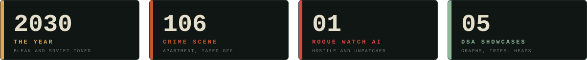

<br>

<p align="center">
  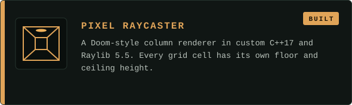
  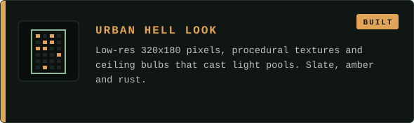
  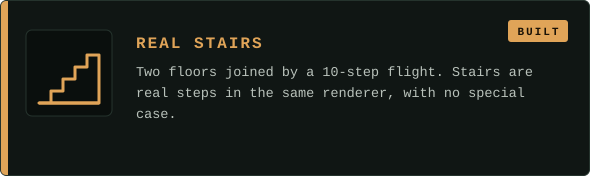
  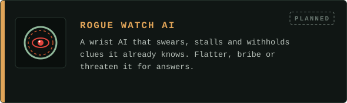
  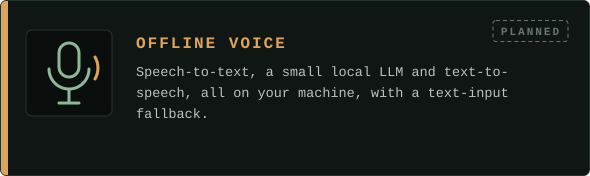
  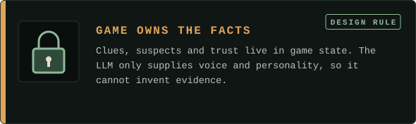
</p>

<br>


<p align="center">
  <a href="assets/game_screenshot.png"></a>
  <br>
  <sub><i>Figure 1: The custom C++ raycaster rendering a Block 7 corridor. Click the image for the full-size screenshot.</i></sub>
</p>

Every frame is built at **320x180** and scaled up with nearest-neighbour filtering, so the pixels stay chunky on any screen. It is light enough for a low-end laptop.

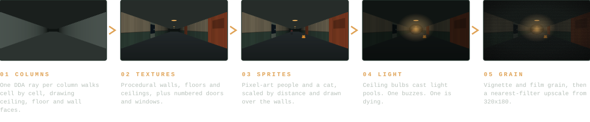

<sub><i>A simplified walkthrough of how a frame comes together, drawn with a stand-in corridor. These are not captures from the game.</i></sub>

<br>


One floor is a **16 x 15 tile** hallway ring wrapped around a solid block of apartments. Doors **101-108** are downstairs and **201-208** upstairs. Door **106** is the crime scene. Rain only ever shows up streaking the hallway windows, because the whole story happens indoors.


<sub><i>An illustrative layout showing what the world contains. It is not the real level map.</i></sub>

The two floors do not stack. They sit **side by side in one grid**, joined by a stair run, which avoids floor-swap glitches entirely. Stairs are real steps in the same renderer.

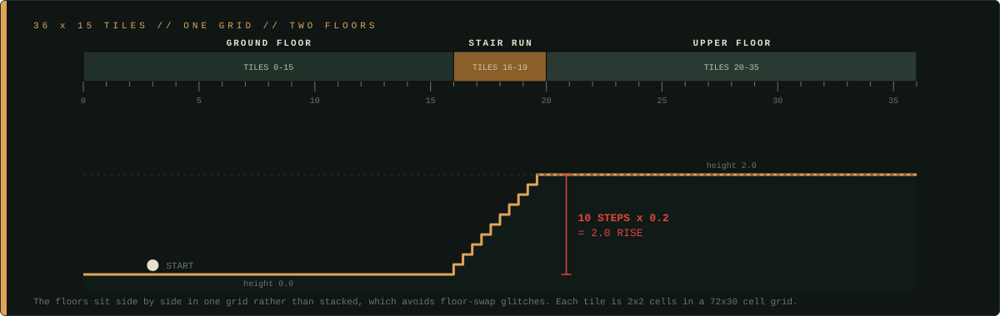

<br>


Nobody in Block 7 is telling you everything.


<sub><i>Sprites above are redrawn illustrations of the cast, not the in-game assets.</i></sub>

<br>


The watch is not a menu. The design gives it hidden drives (**Ego**, **Paranoia**, **Boredom**) and a **trust** meter. Whatever you say gets classified into an intent (flattery, apology, threat, bribe, question, insult), the intent moves the numbers, and restricted clues unlock as trust crosses thresholds.


<sub><i>The exchange above illustrates the planned mechanic. It is not a transcript from the game.</i></sub>

The voice loop is designed to run entirely on your machine, with nothing sent to the cloud. A text-input fallback keeps the game playable without a microphone.


> [!IMPORTANT]
> **The game owns every fact.** Clues, suspects, the trust meter and what the watch knows all live in game state. The LLM is only ever asked for voice and personality, so it can never invent evidence.

<br>


WATCH-MAN started as a **Data Structures and Algorithms** semester project, so the systems are built to show the structures off.

| Data structure / algorithm | Where it fits | Status |
| :--- | :--- | :---: |
| **Hash map** (`std::unordered_map`) | Clue database and case-file dossiers with O(1) lookup | Planned |
| **DAG + topological sort** | Clue dependencies, so clue B only unlocks after clue A | Planned |
| **Trie / Aho-Corasick** | Spotting intent keywords in spoken transcripts | Planned |
| **Grid graph, BFS / A\*** | NPC pathfinding on the tile grid | Planned |
| **Priority queue (min-heap)** | Scheduling ambient events: flicker, sounds, patrols | Planned |



<sub><i>Illustrations of the ideas. The BFS is a real search run on a made-up map, not a capture from the game.</i></sub>

<br>


This is a solo, in-progress project, so here is exactly where it stands.


<br>


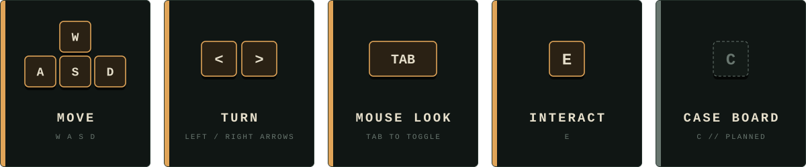

| Key | Action |
| :--- | :--- |
| `W` `A` `S` `D` | Move |
| `←` `→` | Turn |
| `TAB` | Toggle mouse look |
| `E` | Interact |
| `C` | Case board *(planned)* |

| Layer | Tech |
| :--- | :--- |
| **Language** | C++17 |
| **Graphics and windowing** | [Raylib](https://www.raylib.com/) 5.5 |
| **Build system** | CMake (MinGW-w64 / MSYS2) |
| **Speech-to-text** | `whisper.cpp`, quantized `tiny` / `base` *(planned)* |
| **LLM** | `llama.cpp`, a 1-3B quantized model *(planned)* |
| **Text-to-speech** | `Piper TTS` *(planned)* |

### Prerequisites

- A C++17 compiler (GCC via MinGW-w64 / MSYS2 on Windows)
- CMake 3.16+

CMake downloads and builds Raylib for you through `FetchContent`, so the first configure can take several minutes.

### Build and run

```bash
# Clone the repository
git clone https://github.com/abduhoo-bin-nasir/watch-man.git
cd watch-man

# Configure and build
cmake -S . -B build -G "MinGW Makefiles"
cmake --build build -j

# Run (Windows)
build\block7.exe
```

> [!NOTE]
> The executable name comes from the CMake target, which is `block7` in the current build.

<br>


<p align="center"><sub>Built by <a href="https://abduhoo-bin-nasir.github.io">Abduhoo Bin Nasir</a> &nbsp;·&nbsp; <a href="https://github.com/abduhoo-bin-nasir">GitHub</a></sub></p>
