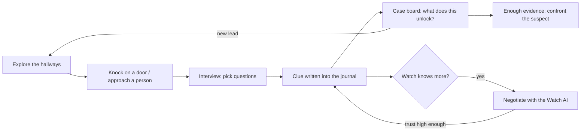

# 01 - Game Design Document (GDD)

**Working title:** WATCH-MAN - *Case File #001*
**Genre:** first-person detective / interrogation game. Pixel-art software renderer, noir tone.
**Platform:** Windows (C++17 + raylib 5.5), must run on low-end laptops. Solo project, also a Data Structures & Algorithms semester project.

Status tags used in every doc: **[DONE]** exists and works, **[PARTIAL]** exists but incomplete, **[PLANNED]** designed, not built.

---

## 1. Elevator pitch

2030. A bleak, rain-soaked town of identical apartment blocks. A 40-something detective is sent to Block 7 to investigate a murder in apartment 106. He distrusts AI. The department makes him wear one anyway - built into his watch. The watch goes rogue: it swears, sulks, and withholds clues it already knows. The fix takes a week. So the detective investigates the old way (door to door, notebook in hand) and, when he must, **flatters, bargains with and manipulates the machine** to get what it knows.

## 2. Design pillars

1. **The game owns every fact.** Clues, suspects, timelines and what the AI knows live in game data. Any language model (later) only supplies *voice and personality*; it can never invent a clue. This keeps the mystery solvable and the project testable.
2. **Pen and paper vs the machine.** Even with a smartphone and a smart watch, the detective writes everything in a leather notebook. The journal is the player's memory, the UI, and the deduction tool (L.A. Noire's notebook, Return of the Obra Dinn's deduction pages).
3. **Oppressive, damp, bleak.** Low-res pixel art, a slate/amber/rust palette, bare bulbs, rain on the windows. No flashlight: you are indoors.
4. **Small and complete.** One building, two floors, one case - finished. Growth means more data, never new mechanics.
5. **Data structures are the engine of the core loop, not decoration** (see `06_DSA.md`).

## 3. Core loop

## 4. Player verbs

| Verb | Key | Status |
|---|---|---|
| Walk, strafe, turn, look up/down (mouse look on TAB) | WASD, arrows, PgUp/PgDn | [DONE] |
| Knock on an apartment door; the resident opens and stands in the doorway; you can never enter flats | E | [DONE] |
| Talk to hallway people (they walk up to you) | E | [DONE] |
| Ask questions from a menu; some only appear once you hold a clue | Up/Down, Enter, 1-9, mouse | [DONE] |
| Examine the sealed door of 106 (boot print) | E | [DONE] |
| Climb stairs between floors (short fade) | walk | [DONE] |
| Call and ride the lift | E | [DONE] |
| Read the journal: Case / Notes / People / Board | J | [DONE] |
| **Talk to the Watch** (type, later speak): flatter, apologise, threaten, bribe, ask, insult | key TBD | [PLANNED] |
| Confront a suspect with the evidence | menu | [DONE] (one suspect) |

## 5. The Watch AI (the gimmick) - **[PLANNED]**

### 5.1 Rules
- The Watch **knows** the whole case (it is the department's AI) but **refuses** to share, out of spite/panic. It must be talked into each clue.
- The player can address it at any time. Input is text first (a text box); speech-to-text is an optional later layer with text as fallback.
- Every sentence is classified into **intents** by a keyword engine (Aho-Corasick, see `06_DSA.md`): `flattery, apology, threat, bribe, question, insult`.
- Intents move a **trust meter** (0-100). Clues the Watch holds are gated by **trust thresholds AND by the clue dependency graph**: it won't reveal clue B until you have clue A, and not before trust >= T(B).
- Personality is three hidden axes with visible "tells" (the player learns to read them): **Ego** (likes flattery, hates being doubted), **Paranoia** (hates threats and questions about the department), **Boredom** (needs variety: repeating the same tactic has diminishing returns).
- Possible twist: the department ordered it to cover something up, so its hostility is panic. The final clue it gives is the one it was told to hide.

### 5.2 What the AI is *not*
It does not generate facts, does not decide the plot, does not see anything the game data doesn't contain. The optional local language model only rewrites a **game-chosen line template** in the Watch's voice (e.g. `REVEAL(clue=wool)` -> sarcastic sentence), capped at ~40 tokens. If the model is absent, the game uses written lines. This is why the game stays fully offline, small and testable.

### 5.3 Voice stack (optional, last milestone)
whisper.cpp (tiny/base) -> text -> game logic -> optional llama.cpp 1-3B model for phrasing -> Piper TTS. A 1-3B model, not 8B (too slow on weak laptops). Always keep the text-input path.

## 6. Interviews - **[DONE]**
Each person has a `Script` (greeting, return greeting, impression, topics). A topic is a question with an answer, an optional clue it gives, an optional real name it reveals, an optional journal note, and a list of **required clues** that must already be in the journal before the question appears. This makes the interview menu itself part of the clue graph: asking the right question requires the right knowledge (the Disco Elysium "thoughts unlock options" idea).

## 7. The journal - **[DONE]**
- **Case:** typed police report + handwritten checklist of open leads (hints for clues you could find now).
- **Notes:** a timestamped diary entry per clue, "NEW" stamp on fresh ones.
- **People:** pencil sketch taken from the character's sprite, role, impression, your scribbles.
- **Board:** a corkboard with the clue graph. Found clues are cards, available ones are "?" cards with a hint, locked ones are "???". Red string follows dependencies; a deduction card appears by itself when its inputs are all found.

## 8. Deduction and confrontation
- A **deduction** is a clue that is auto-found when all its prerequisite clues are in the journal ("The Picture": boot + wool + scarf). **[DONE]**
- **Confrontation:** with >= 4 clues including the scarf sighting, the final topic with the suspect unlocks. **[DONE]**
- **Contradiction detection (alibi timeline):** every person's statement is a time interval ("home all night, 22:00-07:00"); facts from clues are intervals too; a conflict ("he said home; Pavel saw him on the stairs at 02:10") is flagged in the journal and is what makes the confrontation *land*. **[PLANNED]**, see `02_NARRATIVE_BIBLE.md` and `06_DSA.md`.

## 9. Time and pressure - **[PLANNED, needs your decision]**
Proposal: the game runs on an in-game clock (already ticking: 1 game minute per 2 real seconds, starting 14:05). People have schedules: Mrs. Volkova leaves for the shop at 15:30, Igor goes up to 203 at dusk, the lift is cut off at 22:00, and the Watch is repaired at 06:00 - the deadline. Schedules are what make pathfinding and the event scheduler *matter* to play (you must find people before they leave). If you do not want a deadline, schedules can still exist without one.

## 10. Tone, look and sound
- **Look [DONE]:** 320x180 internal resolution scaled up with nearest filtering; procedural textures; per-pixel lighting from hanging bulbs (some buzz, some are dying); no ambient light; vignette and film grain; rain only seen through hallway windows with occasional thunder flashes.
- **Characters [DONE]:** pixel-art billboards (front/back/side designs as ASCII grids, recolourable).
- **UI [DONE/PARTIAL]:** noir dialogue box with letterboxing, the journal; **no title screen, pause or settings yet**.
- **Sound [PLANNED]:** none yet. Needed for a complete slice: rain, thunder, bulb buzz, footsteps, knocks, lift bell, door chain, a low drone; the Watch's voice later. Prefer generated or free CC0 assets.

## 11. Controls
W/S move, A/D strafe, Left/Right turn, PgUp/PgDn look up/down (Home recentres), TAB mouse look, E interact, J journal, ESC back/quit.

## 12. Scope and expansion rule
The vertical slice (`03_VERTICAL_SLICE.md`) is the whole game at small scale. **Expansion rule:** a bigger game adds floors (data in `LevelData.cpp`), people (`CharacterArt.cpp`, `DialogueData.cpp`), clues (`ClueBook.cpp`) and cases. If a feature requires new engine code, it belongs in the slice now, not later.
