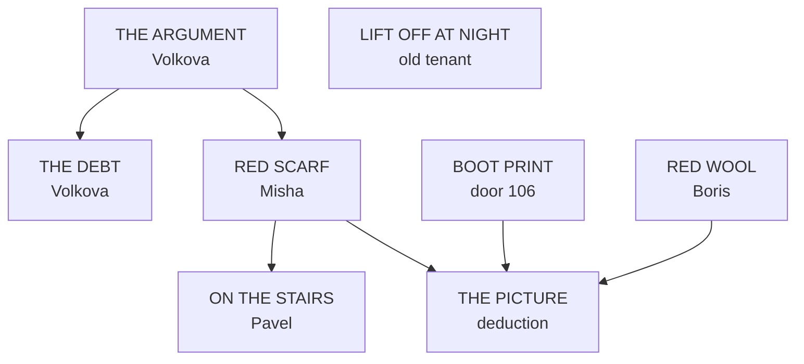

# 02 - Narrative Bible: Case File 30-1112

The single source of truth for the story. Dialogue and clues in the code must agree with this file.

## 1. The truth (what actually happened)

**Victim:** Anton Reznikov, 41, apartment 106, ground floor, Block 7. Quiet, played cards on Fridays, paid his debts on time for years, stopped last month. Drank (bottles in the bin).

**Killer:** Igor Sidorov, apartment 203, second floor. Big man, size-44 boots, wears a red wool scarf. Anton owed him **14,000**; Anton laughed at him.

**Timeline of the night (Tue 12 Nov 2030):**

| Time | Event | Evidence |
|---|---|---|
| 22:00 | The lift is switched off (caretaker's economy drive); from now on everyone uses the stairs | Old tenant (clue *lift off at night*) |
| ~01:50 | Igor knocks at 106; Anton lets him in | Misha, apt 104 (clue *red scarf*) |
| ~02:00 | Loud argument; Anton, who never shouts, shouts back | Mrs. Volkova, apt 101 (clue *the argument*) |
| ~02:00-02:30 | Anton killed (blunt force trauma) | Police report (T.O.D.) |
| ~02:10 | Igor goes down the stairs fast, boots caked with mud | Pavel, janitor (clue *on the stairs*) |
| later | Mud boot print by the hinge of 106; red wool from his scarf snags Boris the cat's collar | Door of 106 (*boot print*), Boris (*red wool*) |
| 07:15 | Neighbour reports; the case starts | Police report |
| 14:05 | The detective arrives (game start) | - |

**Why Igor patrols the ground-floor hallway:** he is watching for the police and for anything left behind. He says he is "taking some air".

## 2. Cast

| id | Name | Where | Knows | Withholds / lies |
|---|---|---|---|---|
| `volkova` | Mrs. Volkova | Apt 101 (answers door) | heard the argument; Anton owed money; points to the boy | nothing - nosy but honest |
| `gromov` | Mr. Gromov | Apt 102 | nothing (headphones, football) | red herring |
| `misha` | Misha | Apt 104 | saw a red-scarf man enter 106 | only talks about it after you know of the argument |
| `petrova` | Mrs. Petrova | Apt 107 | Anton's bottles | red herring |
| `scarf` | Igor Sidorov | hallway ring (ground) | everything | claims "home all night, hardly knew the man" |
| `cat` | Boris | hallway | wears the red wool | - |
| `pavel` | Pavel | second floor | saw Igor on the stairs 02:10 | only mentions it if asked about the scarf man |
| `tenant` | Old tenant | second floor | the lift is cut at night | - |
| *(planned)* | **The Watch** | wrist | the whole case | withholds by design; panics about a cover-up |

Apartments without a resident who answers (103, 105, 108 and all of the second floor) play a "nobody answers" line. 106 is sealed.

## 3. Clue graph (as implemented in `ClueBook.cpp`)

- 8 clues, 4 roots (`argue`, `boot`, `wool`, `elev`), one deduction (`match`, auto-found).
- Depths (used by the board layout): roots 0; `debt`, `scarf` 1; `stairs`, `match` 2.
- **Confrontation requires:** >= 4 clues in the journal **and** `scarf`.
- `elev` is a supporting clue: it makes the stairs the only exit at 2 a.m., so Pavel's sighting means something.

## 4. Statements vs facts (for the planned contradiction system)

Each interval is `(who, where, from, to)`.

| Source | Interval | Type |
|---|---|---|
| Igor: "Home. All night." | (Igor, apt 203, 22:00, 07:00) | **statement** (false) |
| Pavel's sighting | (Igor, stairs, 02:08, 02:12) | fact |
| Misha's sighting | (Igor, apt 106 door, 01:45, 01:55) | fact |
| Volkova: argument in 106 | (voices, apt 106, 01:55, 02:10) | fact |
| T.O.D. | (Anton killed, apt 106, 02:00, 02:30) | fact |
| Igor: "I hardly knew the man." | relationship claim vs the DEBT clue | statement (false) |

Conflicts the detector must find: **Igor-at-203 vs Igor-on-stairs-at-02:10** and **Igor-at-203 vs Igor-at-106-door**. Showing the player these two contradictions is what the confrontation scene is built on.

## 5. Endings
1. **Case closed [DONE]:** you confront Igor with >= 4 clues; he confesses ("Anton laughed at me... fourteen thousand"); a case-closed report lists the journal evidence; "The watch said nothing the whole time. For once I was grateful."
2. **Planned additions (slice):** (a) wrong or premature accusation = the suspect walks and the case goes cold; (b) the Watch's cover-up revealed - alternate last line depending on how you treated it.

## 6. Tone guide for writing lines
Short, dry, tired. Everyone is a little afraid and a little bored. Humour is deadpan. People answer exactly the question asked, never more. The detective's own lines are written like diary entries. The Watch is sarcastic when trust is low, flustered when cornered.
