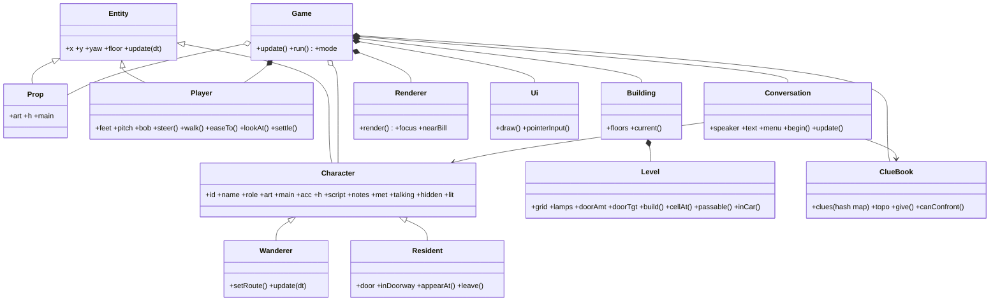
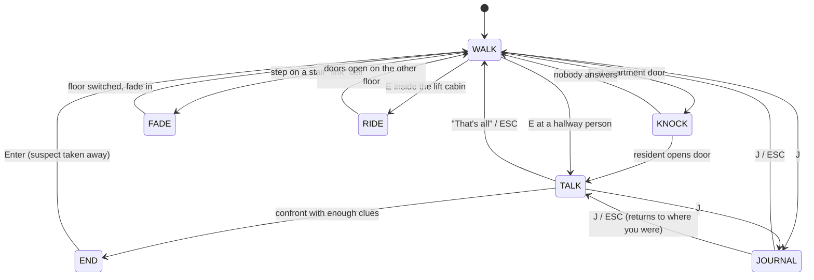
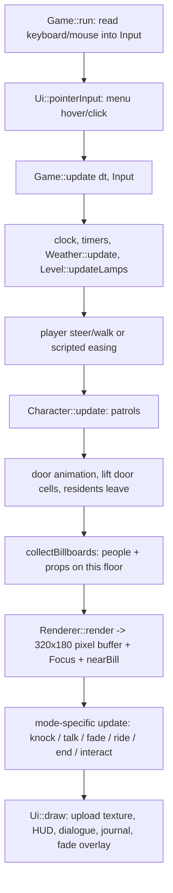

# 04 - Architecture

## 1. Module map

`src/main.cpp` is two lines: `Game game; return game.run();`.

| File(s) | Responsibility | You edit it to... |
|---|---|---|
| `Common.h` | constants (`RW`, `RH`, `WALL_H`...), `RGB`, `V2`, hash helpers, `Input`, `ArtId` | (rarely) |
| `Game.cpp/.h` | the state machine and main loop | change rules/flow |
| `Level.cpp/.h` | ASCII plan -> `Level` grids; `Building` stacks them; stairs, lift doors | (engine) |
| `LevelData.cpp` | **the building**: floor plans, bulbs, flights, who stands/lives where, props | change the map |
| `Entities.cpp/.h` | `Entity > Prop / Character > Wanderer, Resident / Player` | (engine) |
| `CharacterArt.cpp` | **the cast and their pixel designs** | change looks |
| `Dialogue.cpp/.h` | `Conversation`: menu, typing effect, clue hand-out | (engine) |
| `DialogueData.cpp` | **every line people say** | change dialogue |
| `ClueBook.cpp/.h` | **the clues** + the DAG logic | change the case |
| `Renderer.cpp/.h` | the software renderer | (engine) |
| `Ui.cpp/.h` | HUD, dialogue box, journal, ending (draw only) | change how screens look |

Rule of thumb: files ending in `Data.cpp`, plus `CharacterArt.cpp` and the top of `ClueBook.cpp`, are **content**; the rest is **engine**.

## 2. Class diagram

**Inheritance rationale:** `Entity` = anything with a place. `Character` adds identity and dialogue. `Wanderer` and `Resident` differ in *behaviour*, not in data: one walks a route, the other lives behind a door and steps into the doorway. `Player` shares only position and heading, so it is an `Entity` but not a `Character`.

## 3. Game states

During `JOURNAL` the world is frozen (no clock, no patrols). During `KNOCK`/`TALK`/`FADE`/`RIDE` the player cannot move; the camera and position are eased by the game.

## 4. One frame

`Renderer` only fills a memory buffer (no raylib calls), which is why the game logic can be tested without a window.

## 5. Data formats you edit

### Floor plan (`LevelData.cpp`)
One character per **tile**; each tile = 2x2 **cells**. Legend: `#` wall, `W` window, `.` floor, `k` stair handrail wall, `m` metal wall (cabin), `1-8` apartment doors, `E` lift doors, `L` lift cabin, `u`/`d` stair tiles (documentation only). Both floors are 19 x 15 tiles.

### Flights (staircases)
`{tx, ty, dir, lowFloor}`: a flight rises in `dir` over `STAIR_TILES` (5) tiles = 10 steps of 0.2 = one storey. It is laid into **both** floors it joins (on the lower floor F = 0.2..2.0, on the upper floor F = -1.8..0.0), so heights agree cell by cell. `lowFloor = -1` is a flight from the basement (ends in a locked boiler door); `lowFloor = floorCount-1` goes to the roof (locked door).

### Placement of people
`Placement{id, floor, tile, patrol route, speed, facing}` for hallway people; `HomeDef{id, floor, door}` for residents; `PropDef` for crates.

### Cast, dialogue, clues
`CastDef` (appearance + identity), `Script`/`Topic` (words), `ClueBook::add` (case). They connect by **string ids** (`"volkova"`, `"argue"`).

## 6. Design decisions (and why)
| Decision | Reason |
|---|---|
| Each floor is its own grid | The renderer cannot draw a room above another room. Stacking by data + a fade is simple and robust. |
| One `FlightDef` per physical staircase, laid into both floors | The two floors can never disagree about heights; hand-editing two copies would drift. |
| 2x2 cells per tile | A step is half a tile deep, so a flight is 5 tiles = 10 steps. |
| Game owns facts, AI only voices them | Solvability, testability, offline operation. |
| Content in `*Data.cpp` files, strings as ids | Edit story without touching engine code. |
| `Renderer` has no raylib calls | Testable headless; fast; the pixel buffer is uploaded once per frame. |
| ESC backs out of menus | `SetExitKey(KEY_NULL)`; quitting is ESC in WALK only. |
