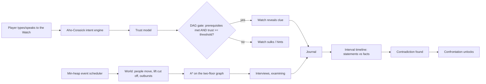

# 06 - Data Structures and Algorithms: audit, verdict and plan

Your instructor's brief: use data structures wherever they make sense, and they must be a **relevant, important** part of the project, not a minor role in an unrelated game. This document answers two questions honestly: *what do we use today*, and *is it enough*.

## 1. The test every structure must pass: the removal test
> If I delete this structure, which part of the **gameplay** stops working?

If the answer is "nothing the player would notice", it is decoration and doesn't count. If the answer is "the core loop collapses", it is central.

## 2. Honest audit of the code today

| Structure / algorithm | Where | What it does | Removal test | Verdict |
|---|---|---|---|---|
| **Hash map** `unordered_map<string, Clue>` | `ClueBook` | clue database by id (`has`, `give`, `clue`) | You could use a `vector` and scan 8 items | **weak**: correct, but with 8 clues any container works |
| **DAG + Kahn's algorithm** (queue, in-degree map, adjacency map) | `ClueBook::buildTopo`, `give` (auto-deduction loop) | orders clues, computes depth, decides when a deduction appears and which clues are "available" | The journal board layout, the "open leads" list, deduction unlock and clue gating all depend on it | **real, and central to the journal** |
| `std::sort` of billboards | `Renderer::drawBillboards` | far-to-near draw order | trivial | **incidental**, do not count it |
| DDA grid traversal | `Renderer::renderColumn` | ray vs grid | the renderer collapses | an algorithm, not a data structure; **great for the report's rendering chapter**, not for the DSA grade |
| Topic gating by required clues | `Conversation::rebuild` | menu items appear when clue prerequisites hold | - | uses the DAG's `has()`; same structure |

**Verdict today: thin.** One genuinely meaningful structure (the clue DAG), one weak one (hash map). Fine for a prototype, **not** enough for what the instructor asked. The original plan listed a Trie, BFS/A*, a min-heap priority queue and a DAG; only the DAG exists.

## 3. The plan: make DSA the engine of the core loop

The core loop of this game is **talk -> learn -> deduce -> confront**. Each stage gets a structure that the stage cannot work without.

### 3.1 Aho-Corasick intent engine **[PLANNED] - the heart of the Watch**
- **Problem:** classify what the player *said* (typed or transcribed) into intents (`flattery, apology, threat, bribe, question, insult`) in real time. A sentence can contain several intents and overlapping phrases ("I'm *not sorry*").
- **Structure:** a **trie** of all keyword phrases, upgraded to an **Aho-Corasick automaton** (failure links computed by BFS over the trie). Each terminal node stores `(intent, weight)`.
- **Why not simple `find`:** scanning the text once per keyword is `O(n * k * m)` and grows with every phrase you add; Aho-Corasick is `O(n + z)` (text length plus number of matches) **regardless of how many phrases** exist. It also naturally finds overlaps. A plain prefix trie (the original plan) is not enough for sentences because it only matches from the start of a string.
- **Optional extension (genuine DP):** speech-to-text mistakes words. A fuzzy fallback computes **Levenshtein edit distance** with dynamic programming against a trie of single words, pruning branches whose row minimum exceeds the threshold (the classic "fuzzy trie search").
- **Complexity:** build `O(total phrase length)`; scan `O(n + z)`.
- **Player-visible effect:** *everything you say to the Watch is processed by it.* Remove it and the central mechanic does not exist.
- **Where:** new `Intent.h/.cpp` (class `IntentEngine`); `Game` owns it.
- **Test:** 50 labelled sentences >= 90% correct; overlap case; empty input; 10,000-character input < 1 ms.

### 3.2 DAG gating of the Watch's knowledge **[PARTIAL: DAG done, gating planned]**
- **Problem:** the Watch knows every clue but may reveal clue B only after A is in the journal **and** trust >= `T(B)`.
- **Structure:** the existing clue DAG plus per-clue trust thresholds. Add a **reverse-edge DFS** to answer "what is blocking this clue?" (all unmet ancestors), which powers the Watch's hints ("Ask Volkova first, genius.") and the journal's "open leads".
- **Complexity:** `O(V + E)` per query; graph has tens to hundreds of nodes.
- **Removal test:** without it the Watch would hand out clues in any order and the case would collapse into a list.

### 3.3 Interval timeline + contradiction detector **[PLANNED] - the deduction engine**
- **Problem:** find lies. Each person's *statement* ("home 22:00-07:00") and each *fact* (sighting at 02:10 on the stairs) is an interval `(who, where, from, to)`. A contradiction is: same person, different place, overlapping time.
- **Structures:** per person, an ordered map (balanced BST, `std::map` or your own AVL/red-black) keyed by start time, so a **sweep** finds overlaps in `O(k log k)`; plus an **interval tree** (augmented BST storing max end) for **stabbing queries**: "which statements/facts cover place X at time t?" in `O(log n + m)`.
- **Why not a plain loop:** with a handful of statements a nested loop works - and that is exactly why the structure must be justified by *scale and by the query it enables*. The stabbing query ("who was near 106 at 02:10?") is what the Watch answers and what the alibi page draws; the sweep is what detects lies as the case grows to dozens of witnesses per floor.
- **Player-visible effect:** the journal grows an **Alibi** page: a timeline bar per suspect with statements above and facts below; contradictions glow red. Finding the two conflicts in `02_NARRATIVE_BIBLE.md` section 4 is the moment the case cracks.
- **Where:** new `Timeline.h/.cpp`.
- **Test:** the two known conflicts are found; a consistent statement yields none; adjacent but non-overlapping intervals yield none; random intervals checked against the `O(n^2)` brute force.

### 3.4 Min-heap event scheduler **[PLANNED]**
- **Problem:** many things must happen at specific in-game times: Volkova leaves for the shop at 15:30, Igor walks to 203 at dusk, the lift is cut at 22:00, the Watch sulks after 10 minutes of silence, thunder, bulb flicker.
- **Structure:** a **binary min-heap** keyed by timestamp (`O(log n)` insert and pop-min). Each frame, pop all events with `time <= now` and dispatch them. Events can reschedule themselves (patrol loops, flicker).
- **Why not scanning a list:** a list is `O(n)` per frame for `n` events; the heap pays only when something is due.
- **Player-visible effect:** the world has a *schedule*: you can miss people, and what you can learn depends on when you ask.
- **Where:** new `Scheduler.h/.cpp`; ideally a hand-written `MinHeap<T>` (about 40 lines) with tests.

### 3.5 Graph model of the building + A* (and BFS) **[PLANNED]**
- **Graph:** nodes = walkable tiles of **both floors**; edges = 4-neighbour moves (cost 1) plus **portal edges**: stairs (cost = steps) and the lift (cost ~6). Built from the `Building`.
- **A\*** with a binary-heap open set; heuristic = Manhattan distance (+ a floor-change term kept admissible). Moves schedule-driven people: Igor to 203 via stairs or lift, Pavel on rounds, Volkova to the shop. It also drives the Watch's *"navigate to apartment X"* arrow, which it only gives you when trust is high (pathfinding with a gameplay purpose).
- **BFS:** (a) the **level validator**: flood-fill from the spawn and assert every door, the lift and both flights are reachable (catches broken maps when you edit `LevelData.cpp`); (b) trivial fallback for tests.
- **Complexity:** A* `O(E log V)` worst case; V is a few hundred tiles per floor.
- **Removal test:** without it people cannot go anywhere that is not a fixed loop, so schedules and the Watch's guidance disappear.
- **Where:** new `Pathfinder.h/.cpp`.

### 3.6 Hash map (keep, but use it where it matters)
Id lookups (clues, scripts, characters). Also used for the intent engine's intent->weight table and for the timeline's `person -> intervals`. Not a headline structure; it is infrastructure.

## 4. Sufficiency verdict after milestones M2-M4

| Structure | Gameplay that vanishes without it | Central? |
|---|---|---|
| Aho-Corasick (+ trie, BFS failure links) | talking to the Watch | **yes** |
| DAG + Kahn + reverse DFS | clue order, deductions, the board, Watch gating | **yes** |
| Interval tree + ordered map | contradiction detection, Alibi page, confrontation | **yes** |
| Min-heap scheduler | timed world, schedules, deadline | **yes** |
| Graph + A* (+ BFS validator) | NPC travel, schedules, Watch directions, level validation | **yes** |
| Hash map | lookups | infrastructure |

Five structures, each tied to a feature a player sees. That is enough, and each has a defensible reason to be there.

## 5. What I would **not** add
A structure with no feature behind it (a skip list "because"), a linked list where a vector is better, a custom allocator. The instructor asked for *relevant* use. Four or five central structures beat ten decorative ones.

## 6. Implement from scratch or use the standard library?
For the course, **write the headline structures yourself** (MinHeap, Trie/Aho-Corasick, interval tree) with unit tests; use `std::unordered_map`/`std::vector` for plain infrastructure. Explain that choice in the report: you implemented what the project depends on, and reused what it doesn't.

## 7. Evidence to prepare for the instructor
1. This table (structure -> feature -> complexity -> removal test).
2. Unit-test output for each structure (a `tests/` folder run by CMake).
3. A micro-benchmark per structure (e.g. 100 A* queries < 5 ms; intent scan of 10,000 chars < 1 ms; scheduler with 10,000 events).
4. A 5-minute live demo path: type an insult to the Watch and watch trust drop; ask the "wrong" clue and be refused with the DAG reason; open the Alibi page; show the contradiction; show the lift-cut event firing; show Igor taking the stairs instead of the lift after 22:00.
5. The pseudocode of each algorithm in the report.

## 8. Build order
`M1` validator (BFS) -> `M2` intent engine + DAG gating -> `M3` scheduler + A* -> `M4` timeline. Each is independent, testable without the window, and ends in a visible feature.
