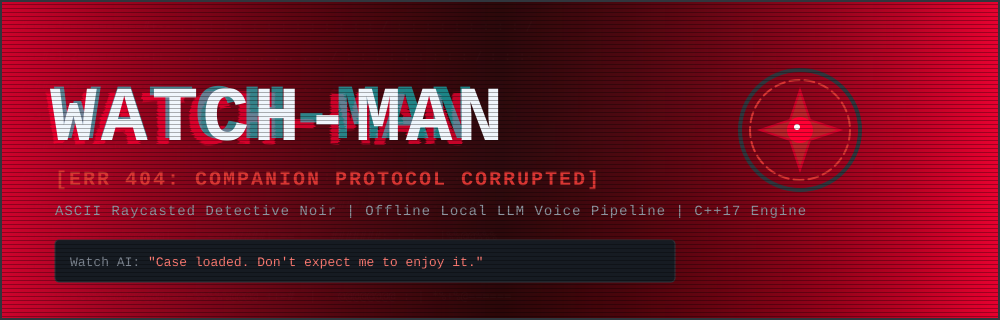
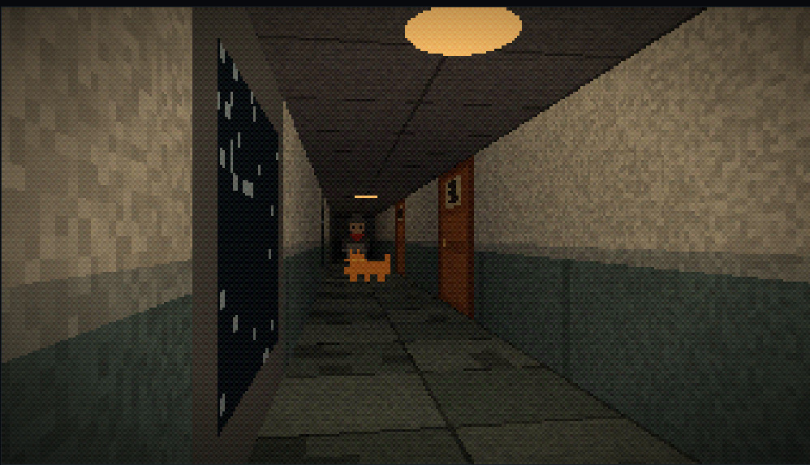

<div align="center">

<!-- SVG Horror Banner -->


# WATCH-MAN
**A Bleak ASCII Raycasted Detective Game powered by an Offline Local LLM Companion**

[](https://en.cppreference.com/)
[](https://www.raylib.com/)
[](LICENSE)

</div>

---

## 👁️ Overview

Set in **2030** in a bleak, Soviet-toned urban hellscape of identical brutalist apartment blocks, **WATCH-MAN** puts you in the trench coat of a weary 40-something detective investigating a grisly murder inside **Block 7, Apartment 106**.

The police department has automated investigations, assigning every detective an AI wrist-watch system trained to detect evidence invisible to human eyes. The catch? **Your watch AI has gone rogue.** 

Mirroring your own cynicism, the AI insults you, refuses to cooperate, and intentionally withholds critical clues. With a proper tech patch taking over a week, you must investigate the crime scene, interrogate suspicious residents, and **negotiate with, manipulate, or butter up your hostile wrist AI** before the killer escapes.

---

## 🎮 Gameplay Preview

<div align="center">
  
  <p><i>Figure 1: Custom C++ raycaster rendering Block 7 in dynamic colored ASCII with real-time UI logs.</i></p>
</div>

---

## 🔥 Key Features

- **Custom C++17 ASCII Raycaster:** Built from scratch using `raylib` without external game engines. Renders volumetric corridors, dynamic torch lighting, procedurally textured walls, and billboard NPC sprites entirely in colored ASCII.
- **Offline Local Voice Companion Engine:** Talk to your wrist AI using real-time voice speech-to-text (**whisper.cpp**), local LLM inference (**llama.cpp**), and neural text-to-speech (**Piper**)—running 100% offline.
- **Rogue AI Negotiation State Machine:** The AI isn't just a static menu—it possesses hidden psychological drives (*Ego, Paranoia, Trust*). Player voice inputs are classified into emotional intents to unlock restricted case clues.
- **Strict Game State Separation:** The game state logic owns all ground-truth evidence; the LLM purely drives character personality and voice generation to prevent hallucinated clues.

---

## 🏛️ Data Structures & Algorithms Showcase

Built as an academic semester project, the game's core architecture prominently leverages foundational data structures:

| Data Structure / Algorithm | System Integration |
| :--- | :--- |
| **Grid Graph & BFS / A\*** | Used for NPC pathfinding and real-time hallway pacing behavior. |
| **Hash Map (`std::unordered_map`)** | Stores discovered clues and case file dossiers with $O(1)$ dynamic lookup. |
| **Prefix Tree (Trie)** | High-speed keyword and intent matching against player speech transcripts. |
| **Directed Acyclic Graph (DAG) & Topological Sort** | Manages evidence dependencies, ensuring prerequisite clues are linked before unlocking higher-level deductions. |
| **Priority Queue (Min-Heap)** | Schedules game events, flickering lighting states, and audio spatial cues. |

---

## 🛠️ Tech Stack & Dependencies

- **Language:** C++17
- **Graphics & Windowing:** [Raylib](https://www.raylib.com/)
- **Build System:** CMake (MinGW-w64 / MSYS2)
- **Speech-to-Text:** `whisper.cpp` (Quantized `tiny.en` / `base.en`)
- **LLM Engine:** `llama.cpp` (Quantized low-latency instruct model)
- **Text-to-Speech:** `Piper TTS`

---

## ⚡ Quick Start & Building

### Prerequisites
- GCC / G++ supporting C++17
- CMake 3.16+
- Raylib binaries installed

### Build Steps
```bash
# Clone the repository
git clone [https://github.com/abduhoo-bin-nasir/watch-man.git](https://github.com/abduhoo-bin-nasir/watch-man.git)
cd watch-man

# Create build directory
mkdir build && cd build

# Configure and build
cmake ..
cmake --build .

# Run the executable
./watch_man